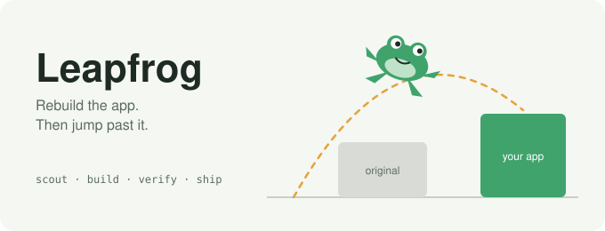
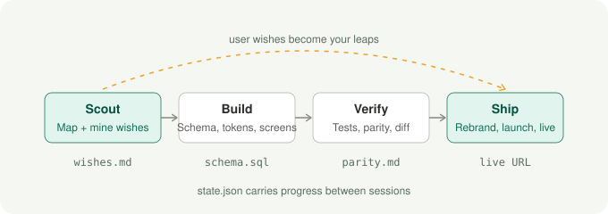
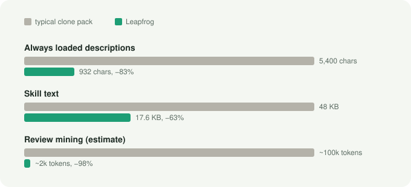

# Leapfrog

<p align="center"></p>

Four Claude skills that rebuild an app and then jump past it.

Most clones copy the features and stop there. Leapfrog also mines what the
original's users already asked for (feature requests, workarounds, the
reasons they left) and builds those in, so your version has a reason to
exist.

<p align="center"></p>

| skill | what it does |
| --- | --- |
| `/leapfrog-scout` | Maps screens, flows and data model. Mines user wishes and competitor gaps. Picks the leaps and the angle. |
| `/leapfrog-build` | Stack, SQL schema, design tokens from computed CSS, screens with every state, auth, payments, integrations. |
| `/leapfrog-verify` | Playwright tests from the flows, bug log, feature parity, leap progress, layout diff that ignores colour. |
| `/leapfrog-ship` | New name and brand, leftover sweep, landing page led by the leaps, pricing, store listing lint, preflight, deploy. |

Free, MIT, no API key, nothing to connect.

## Built to be cheap on tokens

The skills keep Claude's context small. Scripts do the bulk reading and
scoring and print a short summary; Claude opens a full report only when it
needs one.

<p align="center"></p>

| work | how Leapfrog does it |
| --- | --- |
| finding the app's pages | `probe.py` reads sitemaps, groups URLs (help, pricing, changelog, wish boards...). No browsing. |
| reading a page | `probe.py --text URL`: plain text, no browser render. |
| collecting feedback | `wish_fetch.py` pulls official feeds (App Store RSS, Hacker News, GitHub issues). Boards and forums go to a subagent that returns only matching rows. |
| ranking wishes | `wish_rank.py` keeps only sentences that ask, work around or churn, clusters and scores them. Claude reads the top clusters, not 500 reviews. |
| design tokens | `extract_tokens.mjs` reads computed CSS. No screenshots to measure. |
| schema | `model_to_sql.py` drafts the SQL from the data model. Claude only reviews it. |
| layout checks | Screenshots go to disk. `layout_diff.py batch` scores every screen in one call; Claude opens an image only when its score is low. `--since` re-checks only changed screens. |
| resuming | `leapfrog/state.json` holds the step and the facts, so a new session reads one small file. |
| recon | Sharded: an index plus one file per screen and flow. A build step loads one shard. |

## Install

As a plugin in Claude Code:

```
/plugin marketplace add Bambeek/leapfrog-skill
/plugin install leapfrog-skill@leapfrog-skill
```

Or copy the folders (keep `leapfrog-shared`, the skills use it):

```bash
git clone https://github.com/Bambeek/leapfrog-skill.git
cp -r leapfrog-skill/leapfrog-* ~/.claude/skills/
```

Python 3.8+ for the tools, standard library only. `extract_tokens.mjs` and
the tests in your project use Playwright.

## Tools

```bash
python3 leapfrog-shared/state.py show
python3 leapfrog-scout/probe.py https://app.example --out leapfrog/sources
python3 leapfrog-scout/wish_fetch.py --out leapfrog/wishes.csv --apple 123456789 --hn "App"
python3 leapfrog-scout/wish_rank.py leapfrog/wishes.csv --changelog leapfrog/sources/changelog.txt
python3 leapfrog-scout/opportunity.py draft leapfrog/wishes.json --gaps leapfrog/gaps.csv
python3 leapfrog-build/model_to_sql.py leapfrog/recon/model.md --out leapfrog/schema.sql
node    leapfrog-build/extract_tokens.mjs https://app.example/pricing --out leapfrog/design
python3 leapfrog-build/tokens.py all leapfrog/design/tokens.json --out src/styles
python3 leapfrog-verify/parity.py leapfrog/features.csv
python3 leapfrog-verify/layout_diff.py batch leapfrog/screens leapfrog/clone-screens
python3 leapfrog-ship/sweep.py . --config leapfrog/brand.json
python3 leapfrog-ship/listing.py leapfrog/launch/listing.json --brand leapfrog/brand.json
python3 leapfrog-ship/preflight.py
```

Tests: `python3 -m unittest discover -s tests`

## Rules the skills follow

Full text in [`leapfrog-shared/RULES.md`](leapfrog-shared/RULES.md).

- **Rebuild what an app does, never what it owns.** Features, flows and UX
  patterns, written fresh. Not its code, assets, logo, fonts, copy or
  private APIs.
- **Public sources and your own account only.** Official feeds within their
  terms, everything else read like a person reads it. No scraping, no
  logging into other accounts, no paywall tricks.
- **No invented evidence.** Every quote is verbatim and linked, sample sizes
  are stated, thin evidence is labelled thin. No fake reviews or
  testimonials.
- **You own the accounts and the money.** Claude never signs up, pays or
  pastes live keys. Nothing goes live without your go.
- **Ship only as your own.** New name, palette, logo and words. The deploy
  waits until the sweep is clean.

Name checks are screens, not legal clearance. Talk to a lawyer before you
launch if money is on the line. This is not legal advice.

## License

MIT.
